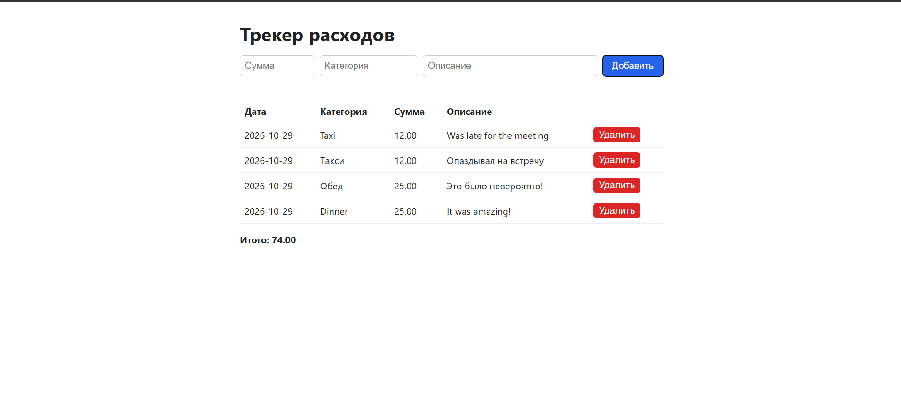

[English](#expense-tracker) | [Русский](#трекер-расходов)

# Expense Tracker

A Python app for tracking personal expenses: a command-line interface, a REST API built with FastAPI, a simple web interface and a Telegram bot. Data is stored in a SQLite database, so nothing is lost when you close the program.

## Features

- Add an expense: amount, category, description, date (set automatically)
- View all expenses and the total amount
- View totals by category
- Edit and delete expenses
- REST API with interactive documentation (Swagger UI)
- Web interface: add, view and delete expenses in the browser
- Telegram bot with separate expenses for every user
- Optional password protection (HTTP Basic) for the API and the web interface
- Data is stored in SQLite (`expenses.db`)
- Input validation (positive amount, non-empty category)
- Automated tests with `pytest`

## Tech stack

- Python 3.12+
- SQLite (`sqlite3` from the standard library)
- FastAPI + Uvicorn
- python-telegram-bot + httpx
- HTML, CSS and vanilla JavaScript for the web interface
- pytest

## Getting started

```bash
git clone https://github.com/TelmanStep2/expense-tracker.git
cd expense-tracker
python -m venv venv
venv\Scripts\activate      # Windows
source venv/bin/activate   # Mac/Linux
pip install -r requirements.txt
```

### Console app

```bash
python main.py
```

### REST API

```bash
uvicorn api:app --reload
```

Then open http://127.0.0.1:8000/docs for the interactive documentation.

| Method | Path | Description |
|---|---|---|
| GET | `/expenses` | List all expenses |
| POST | `/expenses` | Add an expense |
| PUT | `/expenses/{id}` | Update an expense |
| DELETE | `/expenses/{id}` | Delete an expense |

Example request body for `POST /expenses` (the date is optional, today's date is used by default):

```json
{"amount": 50, "category": "food", "description": "lunch"}
```

Expenses belong to a user. The optional `X-User-Id` request header selects whose expenses you work with. Without it, the default owner `web` is used (the web interface and the console app).

### Web interface

With the server running, open http://127.0.0.1:8000/app to add, view and delete expenses in the browser.



### Authentication (optional)

If the `APP_USER` and `APP_PASSWORD` environment variables are set, the API and the web interface ask for a login and password (HTTP Basic). If they are not set, authentication is disabled. The `/` health-check endpoint is always open.

```bash
set APP_USER=admin          # Windows (cmd)
set APP_PASSWORD=secret123
uvicorn api:app --reload
```

On Mac/Linux use `export APP_USER=admin` and `export APP_PASSWORD=secret123`.

### Telegram bot

1. Create a bot with [@BotFather](https://t.me/BotFather) (`/newbot`) and copy the token. Never commit the token to the repository.
2. Start the API (see above), then in a second terminal set the environment variables and run the bot:

```bash
set BOT_TOKEN=your_token_from_botfather
set API_URL=http://127.0.0.1:8000
set APP_USER=admin
set APP_PASSWORD=secret123
python bot.py
```

| Variable | Required | Description |
|---|---|---|
| `BOT_TOKEN` | yes | Token from BotFather |
| `API_URL` | no | API address (default `http://127.0.0.1:8000`) |
| `APP_USER`, `APP_PASSWORD` | if the API is protected | Credentials the bot uses to call the API |
| `ALLOWED_USER_IDS` | recommended | Comma-separated Telegram IDs that may use the bot, for example `111,222`. If empty, everyone can use it |
| `OWNER_USER_ID` | no | Your Telegram ID: the bot then shows the same expenses as the web interface |

Commands:

| Command | Description |
|---|---|
| `/add 50 food lunch` | Add an expense (amount, category, description) |
| `/list` | Show the latest expenses |
| `/total` | Totals by category |
| `/delete 5` | Delete expense number 5 |
| `/myid` | Show your Telegram ID (to add friends to `ALLOWED_USER_IDS`) |

Every Telegram user has their own separate expenses.

### Tests

```bash
pytest -v
```

## Example (console app)

The console interface is currently in Russian:

```
--- Трекер расходов ---
1. Добавить расход
2. Показать все расходы
3. Сумма по категориям
0. Выход
Выберите действие: 1
Сумма: 15
Категория (еда, транспорт...): еда
Описание: обед
Расход добавлен!

Выберите действие: 2
1. 2026-10-27 | еда | 15.00 | обед

Итого: 15.00
```

## Roadmap

- [x] Delete and edit expenses
- [x] Switch from JSON to SQLite
- [x] Tests with `pytest`
- [x] REST API with FastAPI
- [x] Web interface
- [x] Optional authentication
- [x] Telegram bot with per-user expenses
- [ ] Deployment

---

# Трекер расходов

Приложение на Python для учёта личных расходов: консольный интерфейс, REST API на FastAPI, простой веб-интерфейс и Telegram-бот. Данные хранятся в базе SQLite, поэтому не пропадают после закрытия программы.

## Возможности

- Добавление расхода: сумма, категория, описание, дата (ставится автоматически)
- Просмотр всех расходов и общей суммы
- Сумма расходов по категориям
- Редактирование и удаление расходов
- REST API с интерактивной документацией (Swagger UI)
- Веб-интерфейс: добавление, просмотр и удаление расходов в браузере
- Telegram-бот, у каждого пользователя свои расходы
- Необязательная защита паролем (HTTP Basic) для API и веб-интерфейса
- Хранение данных в SQLite (`expenses.db`)
- Проверка входных данных (положительная сумма, непустая категория)
- Автоматические тесты на `pytest`

## Технологии

- Python 3.12+
- SQLite (модуль `sqlite3` из стандартной библиотеки)
- FastAPI + Uvicorn
- python-telegram-bot + httpx
- HTML, CSS и JavaScript без фреймворков для веб-интерфейса
- pytest

## Как запустить

```bash
git clone https://github.com/TelmanStep2/expense-tracker.git
cd expense-tracker
python -m venv venv
venv\Scripts\activate      # Windows
source venv/bin/activate   # Mac/Linux
pip install -r requirements.txt
```

### Консольное приложение

```bash
python main.py
```

### REST API

```bash
uvicorn api:app --reload
```

После запуска откройте http://127.0.0.1:8000/docs, там интерактивная документация.

| Метод | Путь | Описание |
|---|---|---|
| GET | `/expenses` | Список всех расходов |
| POST | `/expenses` | Добавить расход |
| PUT | `/expenses/{id}` | Изменить расход |
| DELETE | `/expenses/{id}` | Удалить расход |

Пример тела запроса для `POST /expenses` (дата необязательна, по умолчанию ставится сегодняшняя):

```json
{"amount": 50, "category": "food", "description": "обед"}
```

Расходы принадлежат пользователю. Необязательный заголовок запроса `X-User-Id` выбирает, с чьими расходами вы работаете. Без него используется владелец по умолчанию `web` (веб-интерфейс и консольное приложение).

### Веб-интерфейс

При запущенном сервере откройте http://127.0.0.1:8000/app: там можно добавлять, смотреть и удалять расходы в браузере.


### Авторизация (необязательно)

Если заданы переменные окружения `APP_USER` и `APP_PASSWORD`, API и веб-интерфейс запрашивают логин и пароль (HTTP Basic). Если они не заданы, защита выключена. Адрес `/` для проверки работоспособности всегда открыт.

```bash
set APP_USER=admin          # Windows (cmd)
set APP_PASSWORD=secret123
uvicorn api:app --reload
```

На Mac/Linux используйте `export APP_USER=admin` и `export APP_PASSWORD=secret123`.

### Telegram-бот

1. Создайте бота через [@BotFather](https://t.me/BotFather) (`/newbot`) и скопируйте токен. Никогда не добавляйте токен в репозиторий.
2. Запустите API (см. выше), затем во втором терминале задайте переменные окружения и запустите бота:

```bash
set BOT_TOKEN=токен_от_botfather
set API_URL=http://127.0.0.1:8000
set APP_USER=admin
set APP_PASSWORD=secret123
python bot.py
```

| Переменная | Обязательна | Описание |
|---|---|---|
| `BOT_TOKEN` | да | Токен от BotFather |
| `API_URL` | нет | Адрес API (по умолчанию `http://127.0.0.1:8000`) |
| `APP_USER`, `APP_PASSWORD` | если API защищён | Логин и пароль, с которыми бот обращается к API |
| `ALLOWED_USER_IDS` | рекомендуется | Telegram ID через запятую, которым можно пользоваться ботом, например `111,222`. Если не задана, ботом может пользоваться любой |
| `OWNER_USER_ID` | нет | Ваш Telegram ID: тогда бот показывает те же расходы, что и веб-интерфейс |

Команды:

| Команда | Описание |
|---|---|
| `/add 50 food обед` | Добавить расход (сумма, категория, описание) |
| `/list` | Показать последние расходы |
| `/total` | Итоги по категориям |
| `/delete 5` | Удалить расход с номером 5 |
| `/myid` | Показать ваш Telegram ID (чтобы добавить друзей в `ALLOWED_USER_IDS`) |

У каждого пользователя Telegram свои отдельные расходы.

### Тесты

```bash
pytest -v
```

## Пример работы (консоль)

```
--- Трекер расходов ---
1. Добавить расход
2. Показать все расходы
3. Сумма по категориям
0. Выход
Выберите действие: 1
Сумма: 15
Категория (еда, транспорт...): еда
Описание: обед
Расход добавлен!

Выберите действие: 2
1. 2026-10-27 | еда | 15.00 | обед

Итого: 15.00
```

## Планы развития

- [x] Удаление и редактирование расходов
- [x] Переход с JSON на SQLite
- [x] Тесты на `pytest`
- [x] REST API на FastAPI
- [x] Веб-интерфейс
- [x] Необязательная авторизация
- [x] Telegram-бот с раздельными расходами
- [ ] Деплой